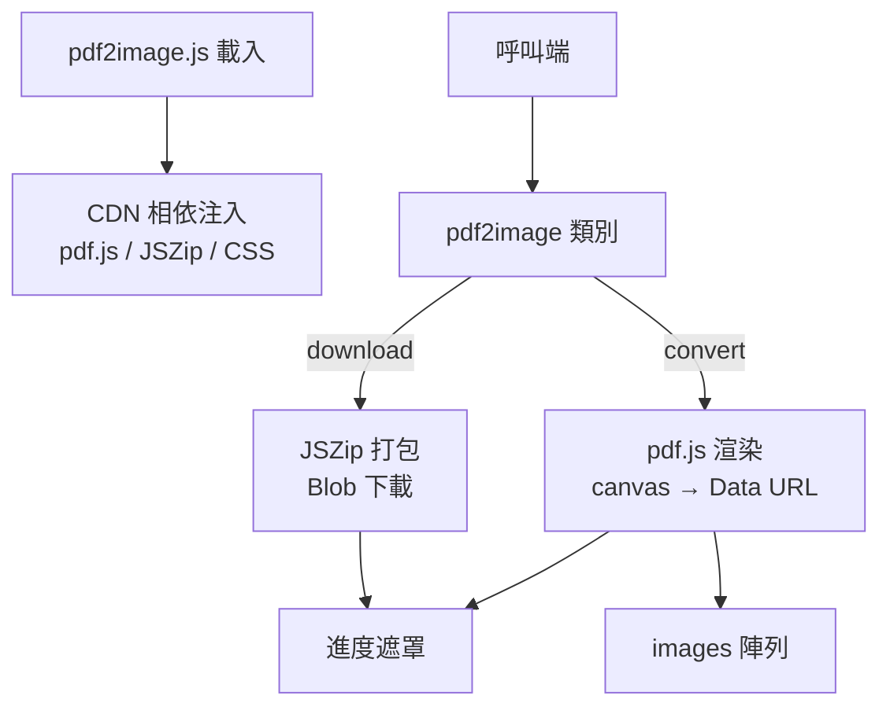

> [!NOTE]
> 此 README 由 [SKILL](https://github.com/agenvoy/skill-readme-generate) 生成，英文版請參閱 [這裡](../README.md)。

***

<strong>TURN ANY PDF INTO IMAGES RIGHT IN THE BROWSER!</strong>

***

> JavaScript 瀏覽器函式庫，具備 PDF 逐頁轉圖片、即時進度遮罩與 ZIP 一鍵打包下載

## 目錄

- [功能特點](#功能特點)
- [架構](#架構)
- [授權](#授權)
- [Author](#author)

## 功能特點

> `npm i @pardnchiu/pdf2image` · [完整文件](./doc.zh.md)

- **純前端轉檔** — PDF 在瀏覽器內由 pdf.js 渲染成 PNG、JPG 或 WebP，檔案不必上傳到任何伺服器。
- **零設定相依載入** — 引入單一 script 即自動從 CDN 預連線並載入 pdf.js、JSZip 與樣式表，無需手動管理相依。
- **頁面併發渲染** — 所有頁面同時以 canvas 渲染，搭配可調 `scale` 在畫質與速度間取捨。
- **內建進度遮罩** — 轉檔與壓縮過程自動顯示百分比遮罩，並依瀏覽器語系切換中英文提示。
- **ZIP 一鍵下載** — 轉出的圖片以 JSZip 打包，檔名支援 `yyyy-MM-DD hh:mm` 日期樣板自動命名。

## 架構

> [完整架構](./architecture.zh.md)

## 授權

本專案採用 [MIT LICENSE](../LICENSE)。

## Author

Just [open an issue](https://github.com/pardnchiu/pdf2image/issues/new) to share an idea.

***

©️ 2024 [邱敬幃 Pardn Chiu](https://www.linkedin.com/in/pardnchiu)
