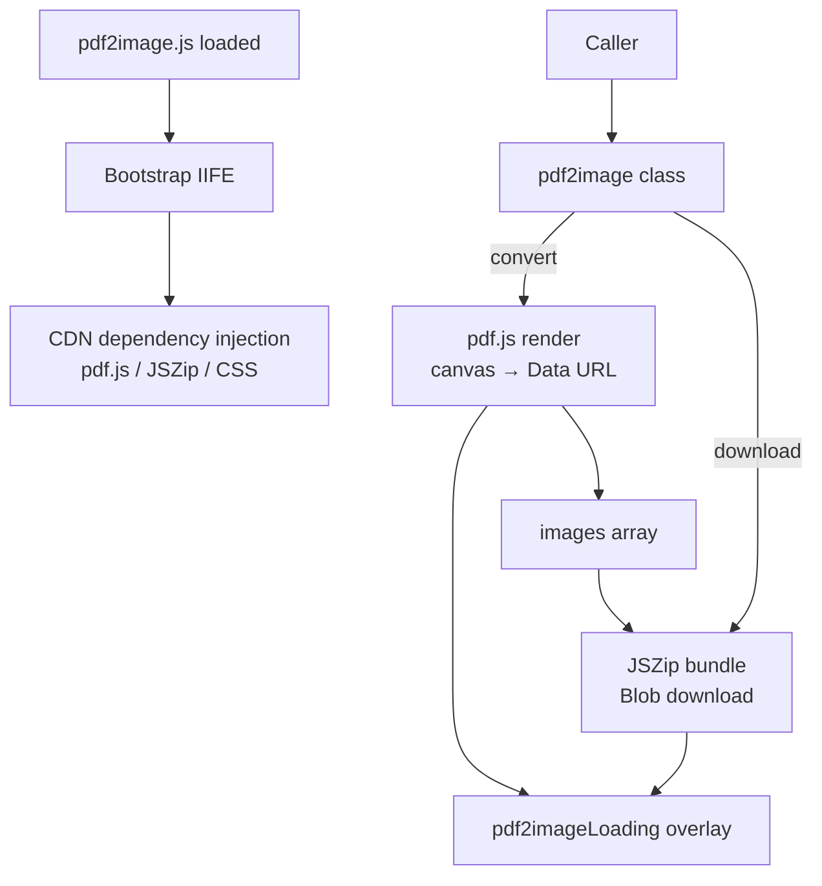
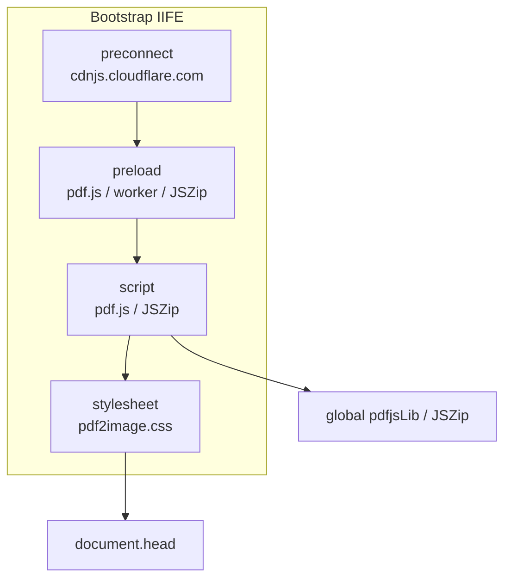
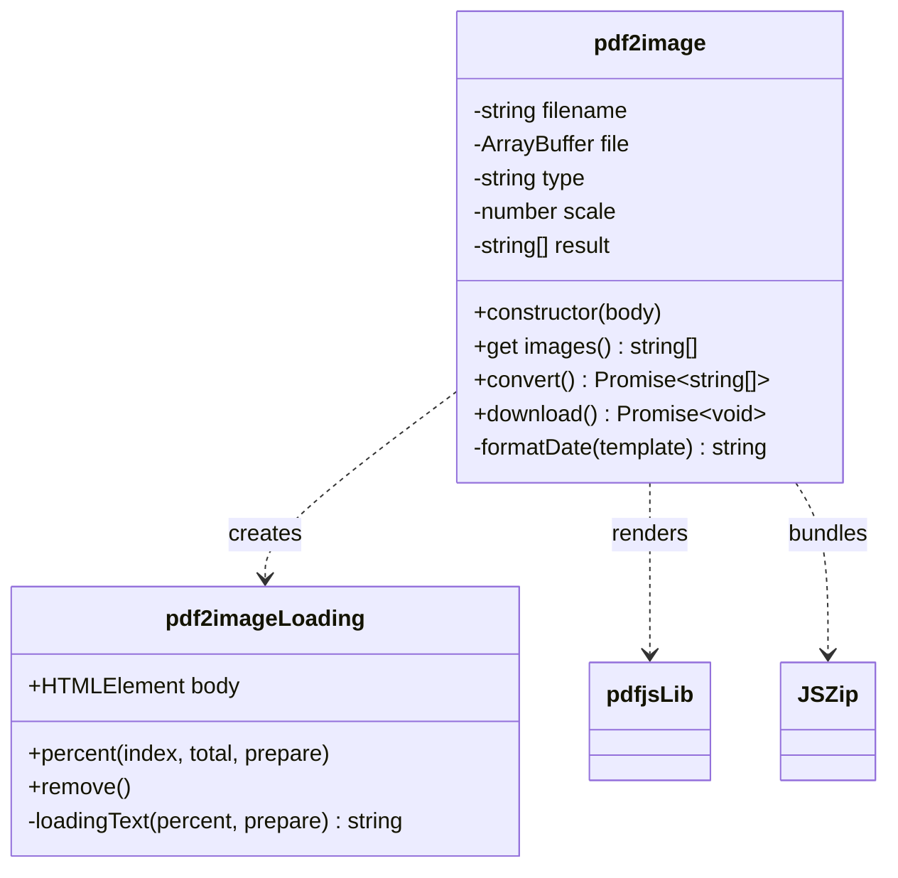
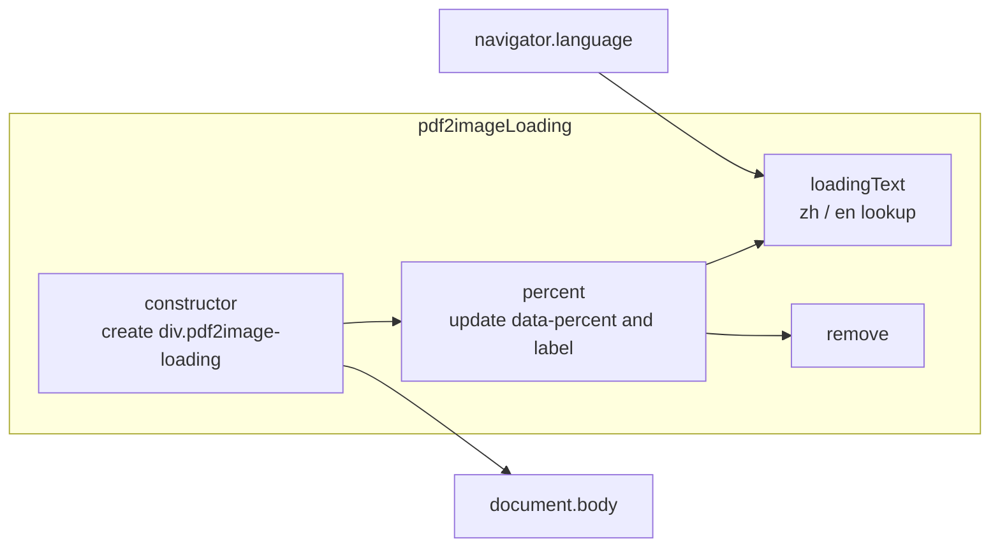
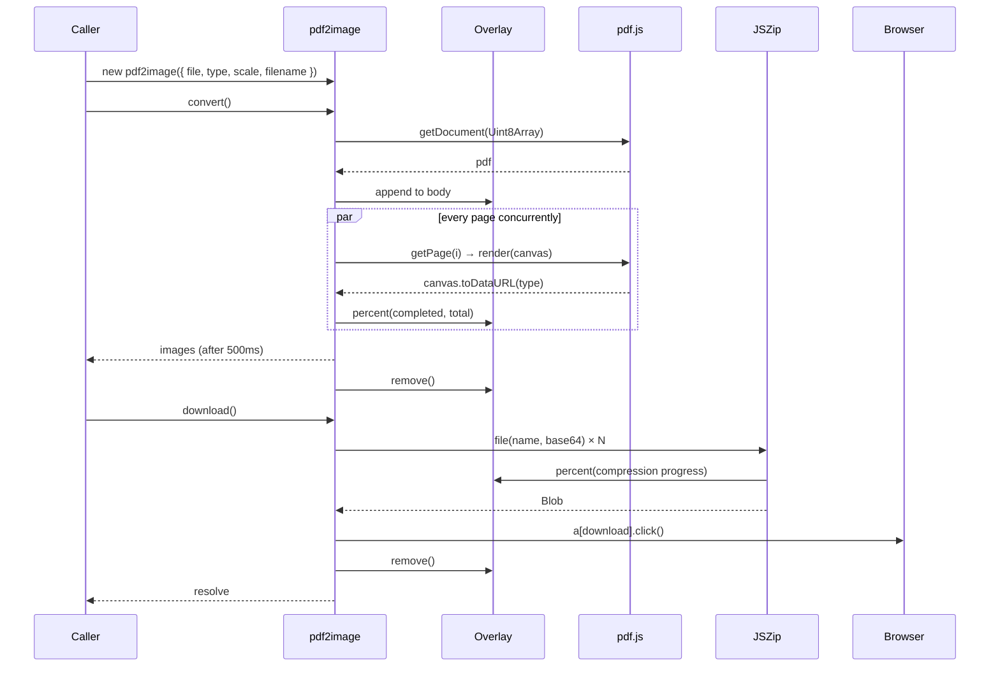
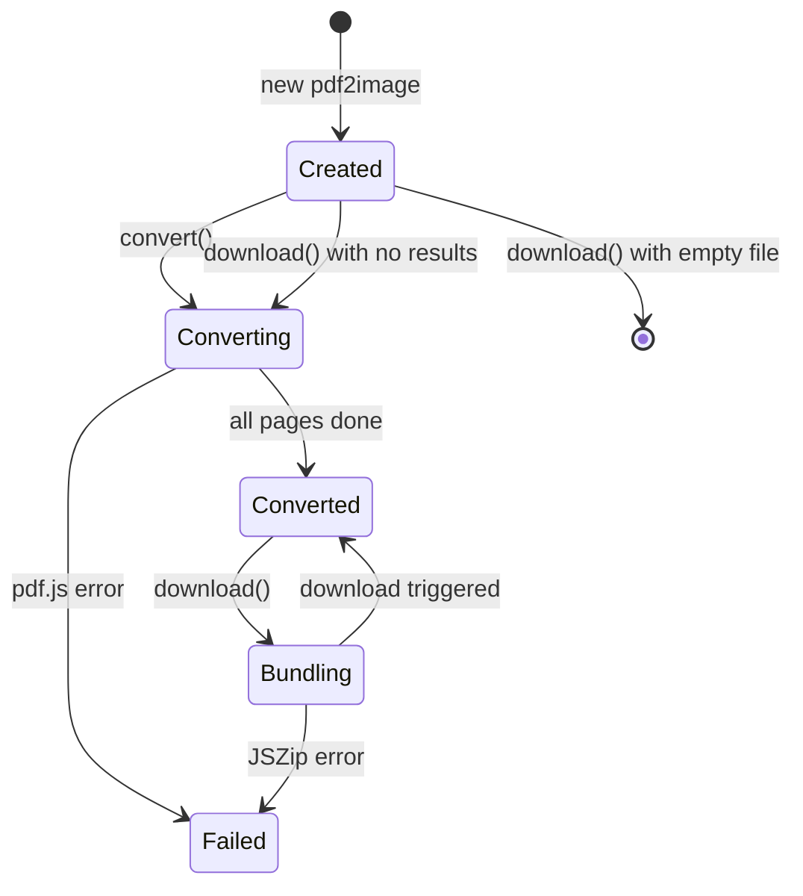

# pdf2image - Architecture

> Back to [README](../README.md)

## Overview

## Module: Bootstrap Injection

Runs immediately on load and attaches external dependencies to `<head>`.

## Module: pdf2image

The only public class; normalizes options, renders pages, and bundles the ZIP.

## Module: pdf2imageLoading

Progress overlay that shows a percentage through `data-percent` and a label localized by `navigator.language`.

## Data Flow

## State Machine

***

©️ 2024 [邱敬幃 Pardn Chiu](https://www.linkedin.com/in/pardnchiu)
