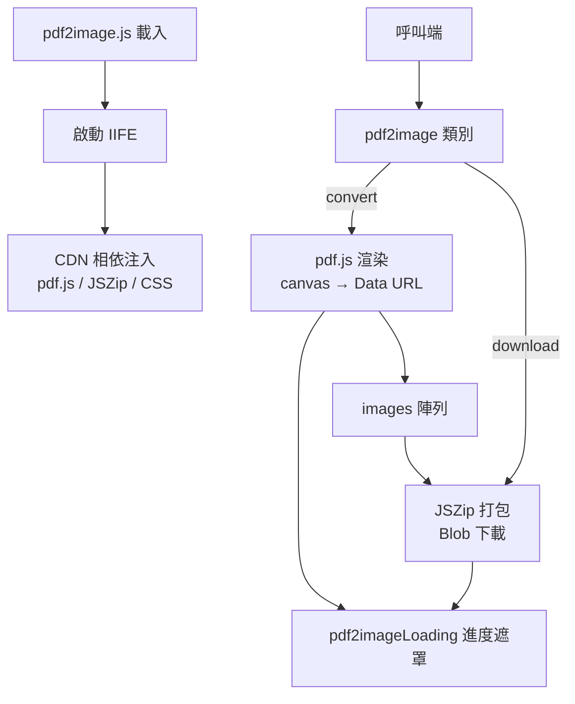
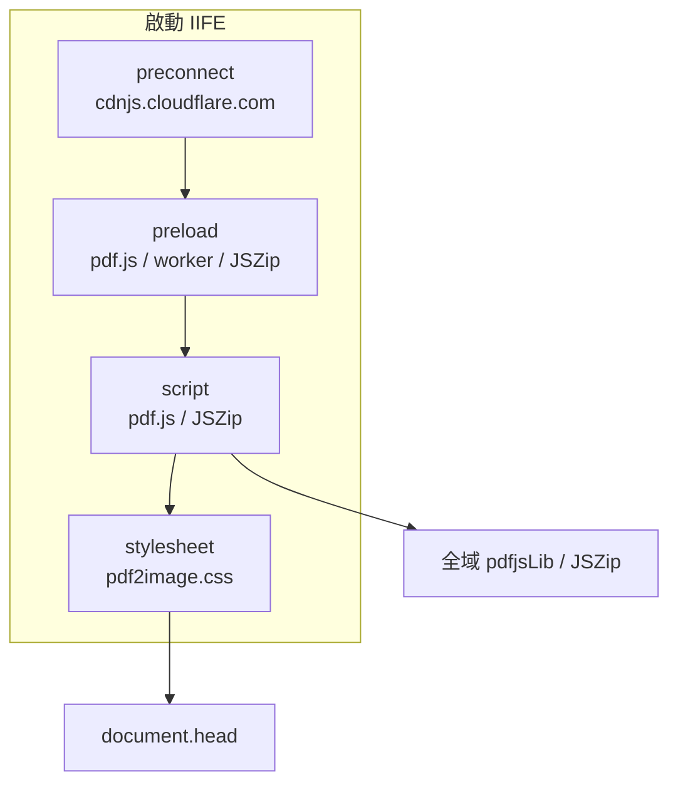
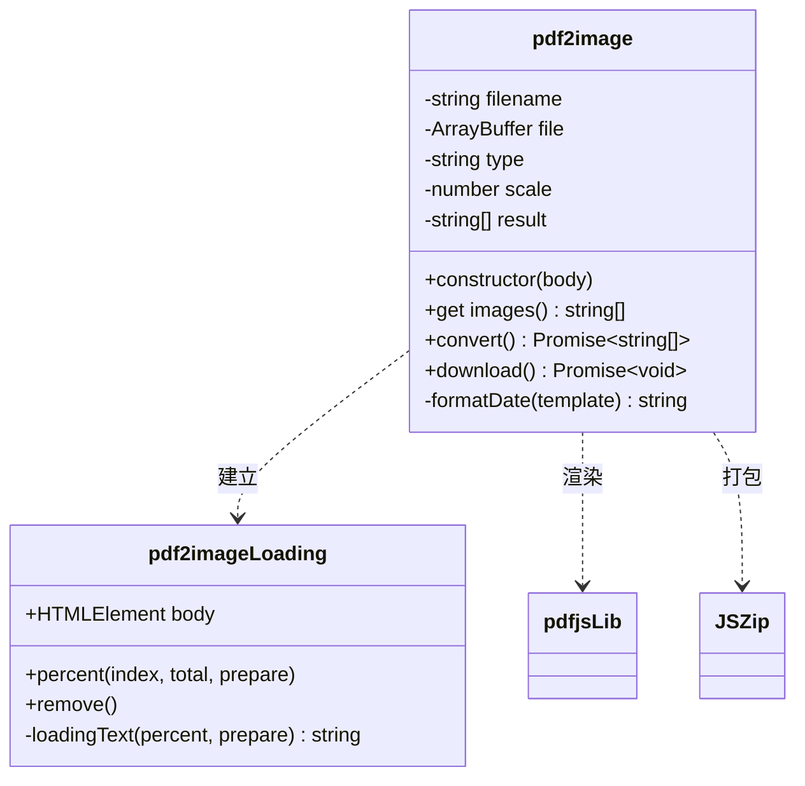
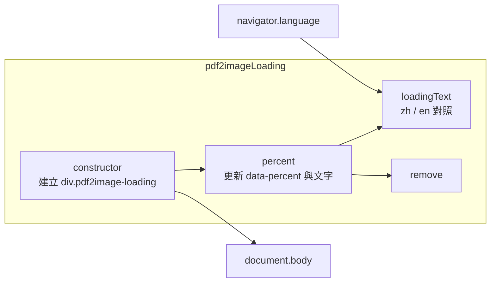
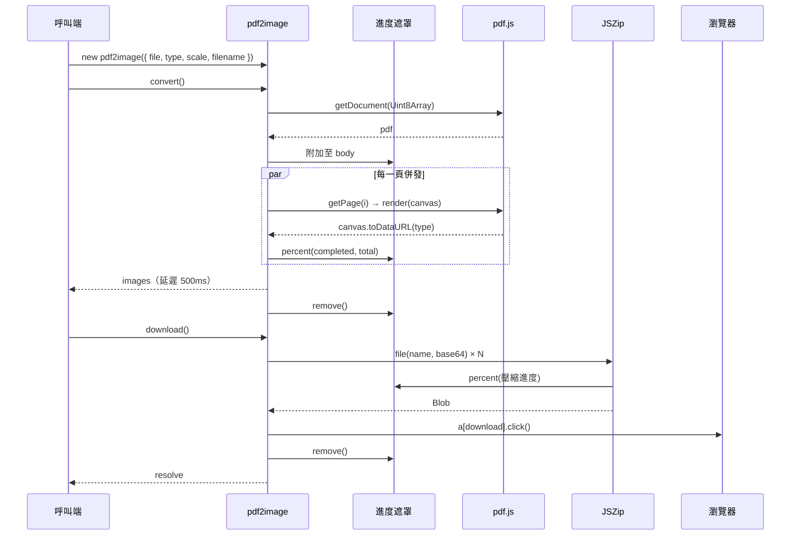
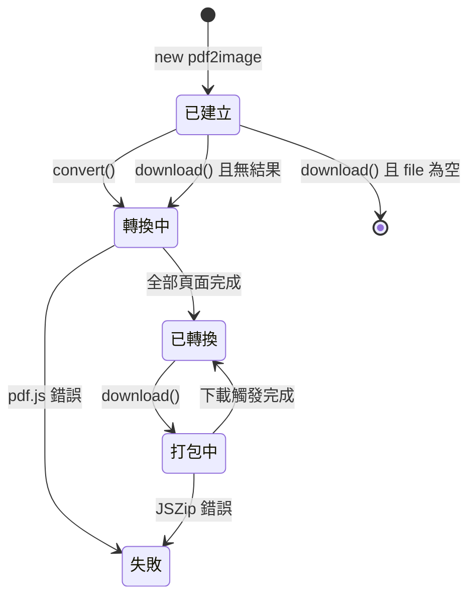

# pdf2image - 架構

> 返回 [README](./README.zh.md)

## 概覽

## Module: 啟動注入

模組載入時立即執行，將外部相依掛入 `<head>`。

## Module: pdf2image

對外唯一類別，負責參數正規化、頁面渲染與 ZIP 打包。

## Module: pdf2imageLoading

進度遮罩元件，以 `data-percent` 與文字呈現百分比，依 `navigator.language` 切換語系。

## 資料流

## 狀態機

***

©️ 2024 [邱敬幃 Pardn Chiu](https://www.linkedin.com/in/pardnchiu)
