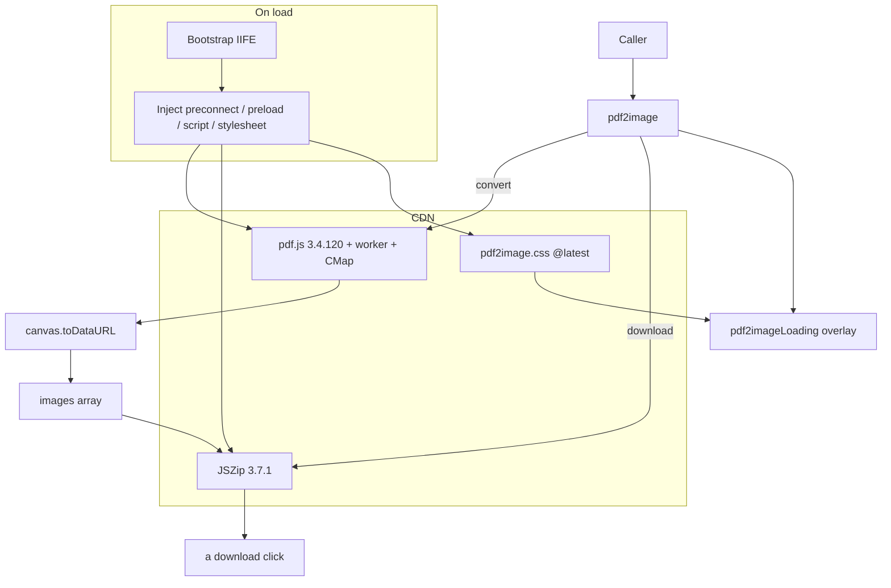

# Architecture

This page gives a one-diagram overview of pdf2image: dependency injection on load, the public `pdf2image` class, the internal progress overlay, and the CDN libraries they rely on.

## System Overview

## Layers

| Layer | Component | Responsibility |
|---|---|---|
| Load | Bootstrap IIFE | Attaches pdf.js, JSZip, and the stylesheet to `<head>` |
| Public API | `pdf2image` class | Normalizes options; `convert()`, `download()`, `images` |
| Internal UI | `pdf2imageLoading` | Creates and updates the progress overlay, switching labels by locale |
| External dependencies | pdf.js, JSZip, browser APIs | Parse and render the PDF, build the ZIP, trigger the download |

## Cross-Cutting Principles

- **No bundled dependencies**: all third-party code is fetched from CDNs at runtime, so the package itself is one small file
- **Client-side only**: the PDF never leaves the browser, and there is no server component
- **Single entry point**: `pdf2image` is the only public class; `pdf2imageLoading` is not exposed
- **Browser-side rendering, Data URL output**: pdf2pic needs Node.js plus GraphicsMagick and Ghostscript, and pdf-to-img converts PDFs in Node.js; both suit servers and build scripts. pdf-img-convert, like pdf2image, is built on pdf.js, but returns PNG `Uint8Array` buffers from an npm module. pdf2image runs in the visitor's page and returns Data URLs that drop straight into ``, with its own progress overlay and ZIP download

## Further Reading

- [Full architecture document (module diagrams, data flow, state machine)](https://github.com/pardnchiu/pdf2image/blob/main/doc/architecture.md)
- [Core Concepts](/core-concepts)
