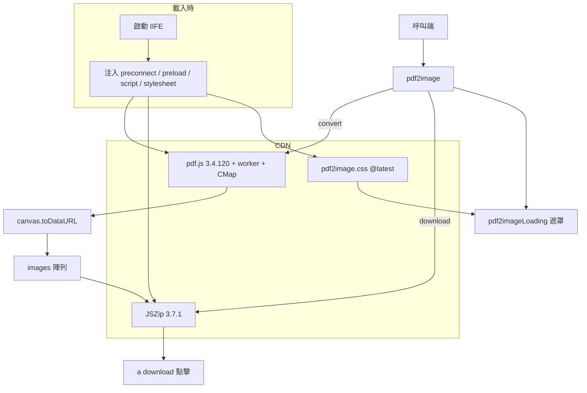

# 架構

本頁以一張圖概覽 pdf2image 的組成：載入時的相依注入、對外類別 `pdf2image`、內部的進度遮罩，以及它們依賴的 CDN 函式庫。

## 系統概覽

## 分層

| 層 | 組成 | 職責 |
|---|---|---|
| 載入 | 啟動 IIFE | 把 pdf.js、JSZip、樣式表掛進 `<head>` |
| 對外 API | `pdf2image` 類別 | 正規化參數、`convert()`、`download()`、`images` |
| 內部 UI | `pdf2imageLoading` | 建立與更新進度遮罩，依語系切換文字 |
| 外部相依 | pdf.js、JSZip、瀏覽器 API | 解析渲染 PDF、打包 ZIP、觸發下載 |

## 跨切原則

- **不打包相依**：所有第三方程式碼都在執行時從 CDN 取得，套件本體只有一個小檔案
- **純前端**：PDF 不離開瀏覽器，沒有任何伺服器端元件
- **單一入口**：對外只有 `pdf2image` 一個類別，`pdf2imageLoading` 不對外暴露
- **在瀏覽器渲染、輸出 Data URL**：pdf2pic 需要 Node.js 加上 GraphicsMagick 與 Ghostscript，pdf-to-img 在 Node.js 中轉換 PDF，兩者適合伺服器與建置腳本。pdf-img-convert 與 pdf2image 同樣以 pdf.js 為基礎，但以 npm 模組回傳 PNG 的 `Uint8Array` 緩衝區。pdf2image 在訪客的頁面中執行，回傳可直接放進 `` 的 Data URL，並內建進度遮罩與 ZIP 下載

## 延伸閱讀

- [完整架構文件（模組圖、資料流、狀態機）](https://github.com/pardnchiu/pdf2image/blob/main/doc/architecture.zh.md)
- [核心概念](/zh/core-concepts)
