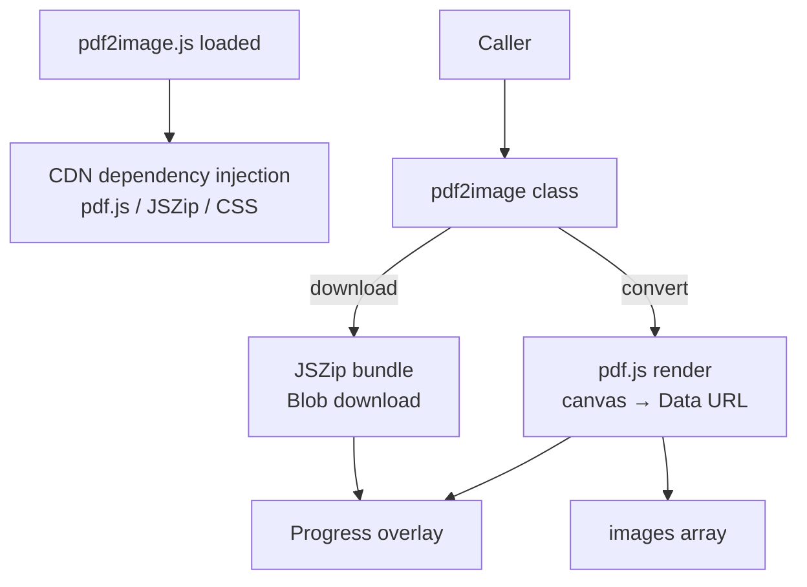

> [!NOTE]
> This README was generated by [SKILL](https://github.com/agenvoy/skill-readme-generate), get the ZH version from [here](https://github.com/pardnchiu/pdf2image/blob/main/doc/README.zh.md).

> [!WARNING]
> **Archived on 2026-10-30.** pdf2image is no longer maintained. The final release is `v1.1.2`; `npm i @pardnchiu/pdf2image` and the jsDelivr build remain available, but no new features, bug fixes, or security updates will be published, and issues and pull requests are no longer accepted.

***

<strong>TURN ANY PDF INTO IMAGES RIGHT IN THE BROWSER!</strong>

***

> A JavaScript browser library with PDF-to-image conversion, live progress overlay, and one-click ZIP download

## Table of Contents

- [Features](#features)
- [Architecture](#architecture)
- [License](#license)
- [Author](#author)

## Features

> `npm i @pardnchiu/pdf2image` · [Documentation](https://github.com/pardnchiu/pdf2image/blob/main/doc/doc.md)

- **Client-Side Conversion** — pdf.js renders each PDF page to PNG, JPG, or WebP inside the browser, so files never leave the user's machine.
- **Zero-Config Dependencies** — A single script tag preconnects to the CDN and loads pdf.js, JSZip, and the stylesheet automatically.
- **Concurrent Page Rendering** — All pages render to canvas in parallel, with an adjustable `scale` to trade quality for speed.
- **Built-in Progress Overlay** — Conversion and compression show a percentage overlay that switches between Chinese and English based on browser locale.
- **One-Click ZIP Download** — JSZip bundles the output images, and filenames accept a `yyyy-MM-DD hh:mm` date template.

## Architecture

> [Full Architecture](https://github.com/pardnchiu/pdf2image/blob/main/doc/architecture.md)

## License

This project is licensed under the [MIT LICENSE](https://github.com/pardnchiu/pdf2image/blob/main/LICENSE).

## Author

Just [open an issue](https://github.com/pardnchiu/pdf2image/issues/new) to share an idea.

***

©️ 2024 [邱敬幃 Pardn Chiu](https://www.linkedin.com/in/pardnchiu)
